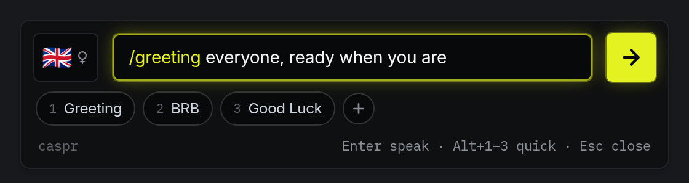
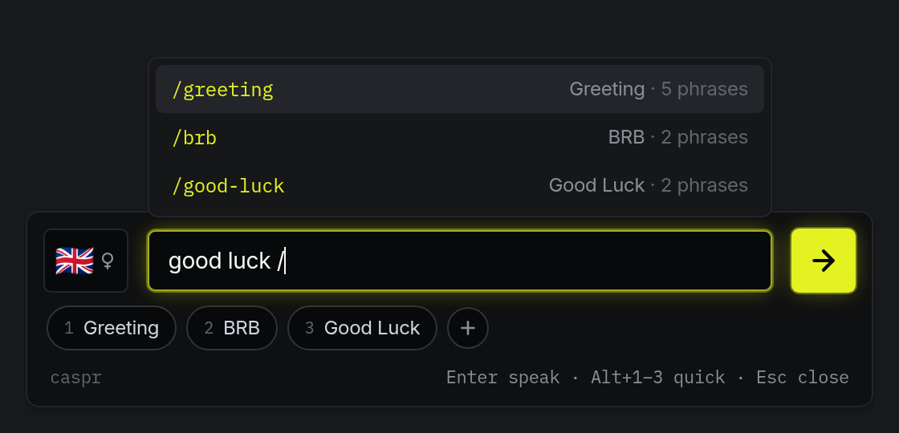
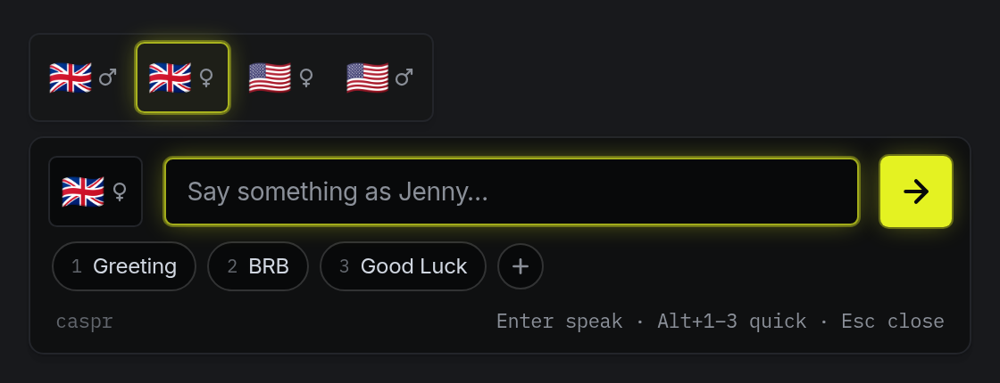
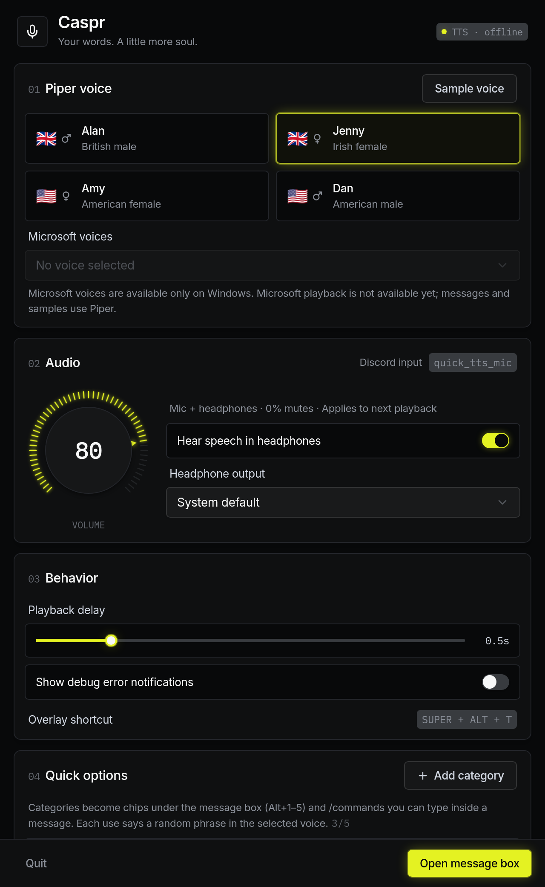
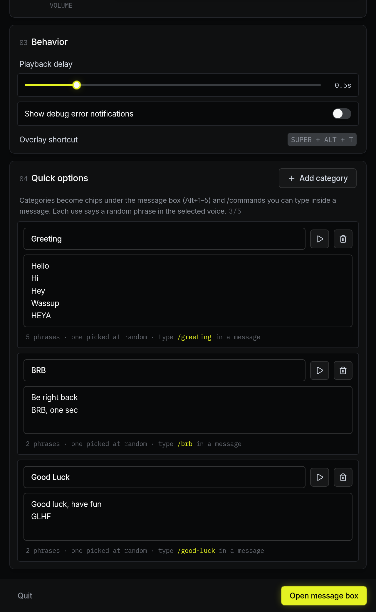

A keyboard-first text-to-speech message box for Omarchy. Type a message, press
Enter, and Caspr speaks it through a PipeWire virtual microphone that Discord
(or anything else) can use as an input. By default you hear it in your
headphones too.



## Features

**Message box**

- `SUPER + ALT + T` opens a compact floating message box. Enter speaks and hides
  it; Escape clears and hides it.
- Messages are spoken in order, with a configurable delay (0.5 s by default).
- A voice button switches between voices on the spot. Each voice shows its
  flag and a ♂/♀ glyph.
- **Quick options**: up to five chips under the input. Click one, or press
  `Alt+1`–`Alt+5`, to say a random phrase from that category. The round **+**
  chip opens Settings at the Quick options section.
- **Slash commands**: type `/greeting` (any category name, lowercase, spaces as
  hyphens) inside a message and it is replaced by a random phrase from that
  category when spoken, e.g. `/greeting everyone` → "Hey everyone". Known
  commands are highlighted in lime as you type.
- **Command menu**: typing `/` at the start of a word lists your categories
  above the input. `↑`/`↓` and Enter or Tab insert one; Escape or Backspace
  closes the menu.

| Slash command menu | Voice switcher |
| --- | --- |
|  |  |

**Settings**

- **Piper voice**: four bundled English voices (Alan, Jenny, Amy, Dan) plus any
  custom `.onnx` model. **Sample voice** plays "I love text-to-speech" in your
  headphones only; samples never reach the virtual microphone.
- **Audio**: a 270° volume knob (mouse, arrow keys or scroll wheel; 0% mutes),
  headphone monitoring on/off, and a choice of headphone output.
- **Behavior**: playback delay, debug error messages and the overlay shortcut.
- **Quick options**: add, rename and delete categories, with one phrase per
  line. Each shows its `/command`, and ▶ says a random phrase right away.
- Settings save automatically as you change them, and voice changes stay in
  sync between Settings and the message box.
- A **Microsoft voices** preference is saved for the upcoming Windows release
  (see below).

| Voices, audio and behavior | Quick options |
| --- | --- |
|  |  |

**Under the hood**

- The virtual microphone appears as **QuickTTS_Microphone** in Discord
  (`quick_tts_mic` internally).
- Caspr keeps one background instance. The first launch starts it; later
  launches (such as the shortcut) just show its window, so reopening takes
  ~150 ms. Closing windows keeps it running, along with the virtual mic, until
  you choose **Quit**.
- Each playback starts with 0.5 s of silence so idle audio outputs can wake up
  before speech begins.
- When debug errors are on, speech errors show in the message box footer and
  as a banner in Settings.

The look follows the "midnight command center" system in
[STYLE_GUIDE.md](STYLE_GUIDE.md): layered near-black surfaces, Inter and
IBM Plex Mono, and one lime accent that glows only on primary, active and
focused items.

## How it's built

- **Python core**: speech queue, Piper synthesis, PipeWire routing and config
  (`src/quick_tts_mic/`).
- **UI**: React + Tailwind in `web/`, using [Watermelon UI](https://ui.watermelon.sh)
  and shadcn components, shown in native windows by
  [pywebview](https://pywebview.flowrl.com/). It uses WebKitGTK on Linux and
  will use WebView2 on Windows.
- The original GTK 4 interface is still available as `quick-tts-mic-gtk`.

## Requirements

- Python 3.11+
- PyGObject and WebKitGTK 4.1 (pywebview's GTK backend)
- Node.js, to build the UI
- PipeWire with its PulseAudio compatibility layer (`pactl`, `paplay`)
- [Piper](https://github.com/OHF-Voice/piper1-gpl) and a compatible `.onnx`
  voice model with its neighboring `.onnx.json` file

## Run from the repository

```bash
python -m venv --system-site-packages .venv
.venv/bin/python -m pip install -e '.[web]' -r requirements-dev.txt -r requirements-tts.txt
npm --prefix web install
npm --prefix web run build
.venv/bin/quick-tts-mic            # Settings
.venv/bin/quick-tts-mic overlay    # message box
```

`--system-site-packages` lets the virtual environment use Omarchy's
system-provided PyGObject while keeping Piper, pywebview and test tooling local
to this project. Rebuild the UI (`npm --prefix web run build`) after changing
anything in `web/`.

Select **QuickTTS_Microphone** as Discord's input device, then use **Open
message box** in Settings to test before installing the shortcut.

Voice models live in the ignored `data/voices/` directory and are discovered
automatically. This checkout uses `en_GB-alan-medium` (Alan, British male),
`en_GB-jenny_dioco-medium` (Jenny, Irish female), `en_US-amy-medium`
(Amy, American female) and `en_US-hfc_male-medium` (Dan, American male).

### Developing the UI

Run `npm --prefix web run dev`, then start Caspr with
`CASPR_WEB_URL=http://localhost:5173` to load the live Vite server instead of
the built files. Set `CASPR_WEB_DEBUG=1` to enable the web inspector. Python
tests run with `.venv/bin/python -m pytest`.

## Omarchy shortcut

First run `omarchy menu keybindings --print` and confirm `SUPER + ALT + T` is
unused. Then add this to `~/.config/hypr/bindings.lua`, replacing the repository
path if needed:

```lua
o.bind("SUPER + ALT + T", "Caspr TTS", "/home/jacq/Work/quick-tts-mic/scripts/quick-tts-overlay")
```

Validate the change:

```bash
hyprctl reload
hyprctl configerrors
```

If the shortcut is already assigned, add `hl.unbind("SUPER + ALT + T")` before
the new binding and note what it previously did.

This development checkout installs an app-menu entry named **Caspr TTS** in
`~/.local/share/applications/` and binds the overlay shortcut in the user's
Omarchy `bindings.lua`. Both launch the project-local virtual environment.

## Current limits

- Up/Down message history from the GTK prototype is not in the new UI yet.
- Speech errors are shown in the app, not as desktop notifications.
- Piper/model installation is not automated yet.
- The virtual microphone exists only while Caspr runs.
- Shortcut editing is manual.
- Live PipeWire and Hyprland behavior must be tested inside the desktop session.

### Microsoft voice preference (Windows release preparation)

Settings includes a separate Microsoft voices dropdown. On Windows, install the
optional discovery support with `pip install '.[windows-voices]'`. It uses PyWinRT
and Windows `SpeechSynthesizer.all_voices` to list only installed voices exposed
by that API. Restart Caspr after changing installed voices to refresh the list.

The preference is saved independently of the Piper model. Missing saved voices
are not replaced automatically. On Linux/Omarchy or when discovery is unavailable,
the dropdown is disabled and the saved preference is preserved.

Microsoft playback is not available yet: messages and samples still use Piper.
The pywebview UI is designed to run on Windows (WebView2), but the audio routing
is still PipeWire-only; see [the Windows release plan](docs/WINDOWS_RELEASE_PLAN.md).
